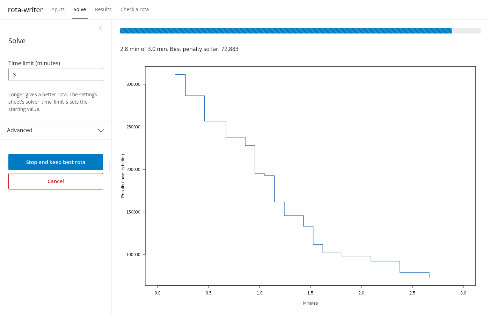
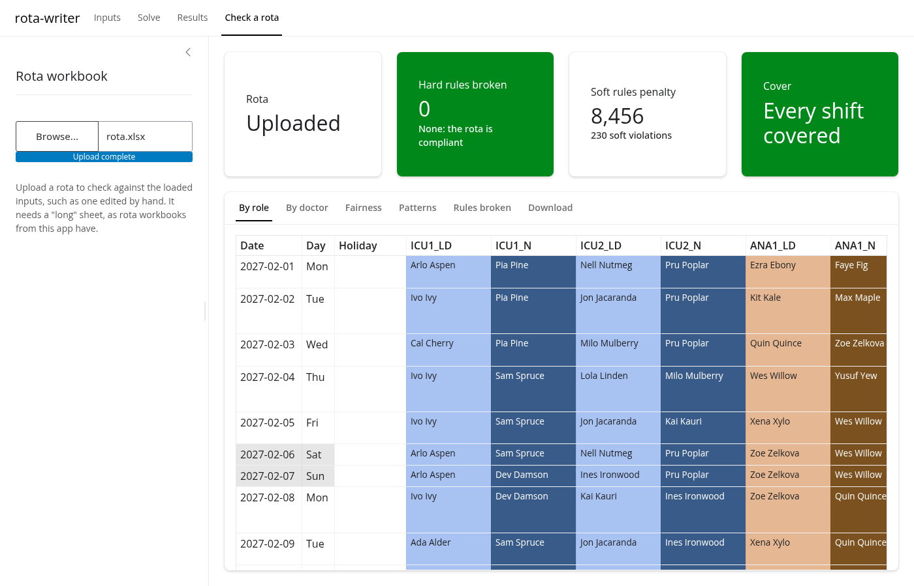
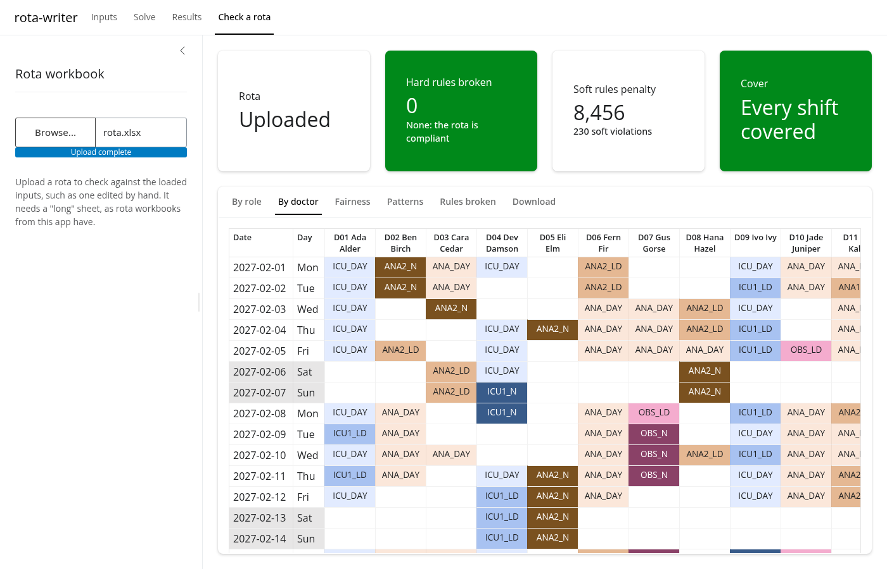

<div align="center">

# 🩺 rota-writer

**Fair, contract-compliant on-call rotas for doctors**

[](LICENSE.md)
[](LICENSE-docs.md)
[](https://www.r-project.org)
[](https://highs.dev)


</div>

Fair, contract-compliant on-call rotas for doctors, written by mathematical optimisation and checked
independently. You describe your rota in one Excel workbook; rota-writer finds the best rota that
meets every hard rule, and a separate checker proves it.

rota-writer is **open source and copyleft**: the code is [AGPL-3.0-or-later](LICENSE.md) and the
docs [CC BY-SA 4.0](LICENSE-docs.md), so it can never be taken private or sold back as a black box.
It is **privacy-respecting**, running entirely on your own computer with no accounts, tracking or
cloud service, and **interoperable**, reading and writing ordinary Excel workbooks and `.ics`
calendars with the open-source [HiGHS](https://highs.dev) solver underneath.

🚧 **Status:** early development, but working end to end: a point-and-click app, the command line and
R all solve and check rotas, with a coordinator workbook, a compliance report and per-doctor
calendars. Two worked examples are included: [resident doctors](#resident-doctors-anaesthesia-and-icu)
and [ICU consultants](#icu-consultants).

<details>
<summary><strong>Contents</strong></summary>

- [Why optimisation, not "AI rota-writing"](#-why-optimisation-not-ai-rota-writing)
  - [Where AI does help: turning your requirements into rules](#where-ai-does-help-turning-your-requirements-into-rules)
- [Installation](#-installation)
  - [With an AI agent](#with-an-ai-agent)
  - [Manual installation](#manual-installation)
- [Usage](#-usage)
  - [Setting up a rota with an AI agent](#setting-up-a-rota-with-an-ai-agent)
  - [Setting up a rota by hand](#setting-up-a-rota-by-hand)
  - [Solving and checking: the app](#solving-and-checking-the-app)
  - [Solving and checking: the command line](#solving-and-checking-the-command-line)
  - [From R](#from-r)
- [Example rule sets](#-example-rule-sets)
  - [Resident doctors: anaesthesia and ICU](#resident-doctors-anaesthesia-and-icu)
  - [ICU consultants](#icu-consultants)
- [The inputs workbook](#-the-inputs-workbook)
  - [Rota types](#rota-types)
- [Rule catalogue](#-rule-catalogue)
- [Technical methods](#-technical-methods)
- [Development](#-development)
  - [Roadmap](#roadmap)
- [Prior art](#-prior-art)
- [Licence](#-licence)

</details>

## 🧮 Why optimisation, not "AI rota-writing"

A rota is a puzzle with thousands of interlocking rules: rest after nights, weekend frequency,
average hours, who is signed off for what, leave, fairness, and the local conventions everyone
relies on. There are two very different ways a computer can help.

**Generative or "black-box" AI** produces a rota that *looks* right. A chatbot asked to write a rota
predicts plausible text; a system trained on past rotas copies past habits, unfairness included.
Neither can guarantee that every rule holds, or explain why Dr A got more weekends than Dr B.

**Mathematical optimisation**, which rota-writer uses, works the other way round. Every possible
assignment is a yes/no decision ("does Dr A work the ICU night on 3 March?"), and every rule is an
exact equation over those decisions. A solver then searches for the rota with the lowest total
penalty, and the method is called *mixed-integer linear programming* (MILP). This means:

- **Hard rules are guaranteed.** Contract limits, competencies and approved leave cannot be broken.
  If the rules make a shift impossible to fill, you get an empty slot and a report saying so, never
  a quiet breach.
- **Trade-offs are yours, and visible.** Softer wishes (fair shares, requested leave, no single
  nights, whole weekends off) each have a penalty weight in the workbook. The solver balances them
  by those weights, and the report shows exactly which were broken, and what each cost.
- **Same inputs, same rota.** The search is seeded, so results can be reproduced and audited.
- **Checked twice.** An independent checker, written a different way, re-checks every rota,
  including ones edited by hand.

### Where AI does help: turning your requirements into rules

The hard part of setting up a rota is translation, from "how our rota works" to sheets, rules and
weights. This is what large language models (LLMs) are good at, so rota-writer ships instructions
(*skills*) for AI coding agents such as Claude Code, Codex, Cursor or Gemini CLI. The agent
interviews you about your rota, writes a plain-English spec you can read and correct, maps each
requirement to a rule (and tells you honestly when something can't be done yet), turns your
priorities into penalty weights, and helps you tune them on trial rotas.

The division of labour is strict:

| Who | Does |
|---|---|
| You | Describe the rota, rank what matters, and judge the results |
| The AI agent | Translates your description into the spec, the inputs workbook and the weights |
| The solver | Decides who works when, mathematically, within those rules |
| The checker | Independently confirms every rule, and reports every penalty |

The language model never decides who works when, and nothing it writes is hidden: the spec, the
workbook and the report are all readable by the rota coordinator.

## 📦 Installation

### With an AI agent

If you use an AI coding agent, let it do the installing. Open the agent in an empty folder and ask:

> Set up rota-writer from https://github.com/mark-jeffrey/rota-writer, following its `rota-setup`
> skill (`.agents/skills/rota-setup/SKILL.md`).

The skill walks the agent through installing R on Windows, macOS or Linux, downloading the project,
installing the packages, checking the install with a short solve, and starting the app. It explains
each step in plain words and asks before anything that needs administrator rights. It also covers
locked-down work PCs. Once you're inside the project folder, "set up rota-writer" is enough:
[`AGENTS.md`](AGENTS.md) points any agent to the skills, and Claude Code also finds them in
`.claude/skills/`.

### Manual installation

You need R 4.3 or newer ([cran.r-project.org](https://cran.r-project.org)). On Linux you also need
`cmake`, because the `highs` solver package builds from source there.

```sh
sudo apt install cmake        # Linux only; or: sudo dnf install cmake / sudo pacman -S cmake
git clone https://github.com/mark-jeffrey/rota-writer.git   # or download the ZIP from GitHub
cd rota-writer
Rscript scripts/setup.R
```

`setup.R` installs any missing R packages, then solves the example rota for a minute to check that
everything works. Options: `--no-app` skips the app's packages, `--templates` adds tidyverse (needed
to write a new inputs workbook from a script), and `--no-check` skips the check solve. The scripts
load the package straight from the folder, so there is nothing else to install. Run them from the
project root.

To start the app from a desktop icon on Windows, install the package once (`R CMD INSTALL .`) and
copy `inst/launchers/rota-writer.bat` to the desktop. With the package installed,
`rotawriter::run_app()` also starts the app from any R session.

## 🚀 Usage

### Setting up a rota with an AI agent

**Use anonymised or dummy data with the agent.** Rules and weights depend on the *shape* of your
staff group (how many people, their grades, WTE, competencies, LTFT days, typical leave), not on
who they are. So give the agent staff codes such as `C01` or "Consultant A" instead of names,
and realistic but made-up leave and preferences, or let it generate them. If you share your
current rota, replace the names with the same codes first. Only share real staff data with an AI
tool your organisation has approved for personal data.

Open your agent in the rota-writer folder and ask it to set up a rota for your department. The
`rota-ruleset` skill takes it through eight steps:

1. **Intake:** questions about your contract, shifts, cover, staff, skill mix, the conventions to
   keep (blocks, night splits, sequences), leave and preferences. Share your current rota if you
   have it: it shows the conventions people rely on without saying so.
2. **Mapping:** each requirement is matched to a sheet or rule. Anything rota-writer can't do yet is
   flagged, and you rank the soft requirements.
3. **Gaps:** you decide whether each gap is left out, approximated or added as a new rule.
4. **Build:** a feasibility check (enough people for the shifts?), then your inputs workbook.
5. **Weights:** penalty weights from your ranking, each checked against a concrete trade-off.
6. **Trial:** short trial solves, with a review of fairness, patterns and broken preferences.
7. **Tuning:** questions about real examples ("is this the right call?"), changing one weight at a
   time.
8. **Handover:** a full-length solve, and how to run the next rota period.

Everything is recorded in a plain-English spec, `local/<dept>/rota-spec.md`, which you can read and
correct, and which another session or agent can pick up from.

**Then add your real data yourself, without the agent.** Open the finished inputs workbook in Excel
and replace the dummy rows in `staff`, `leave`, `requests` and `preferences` (and `placements`, if
you use them) with your real ones, keeping the same columns. Leave the `rules`, `shifts`, `cover`
and other structure sheets as they are: those are your rule set. Then solve in the app or with
`scripts/solve_rota.R`, which run entirely on your computer. If the app lists problems with the
inputs, or the rota has unfilled slots, your real staff group differs from the dummy one in a way
that matters (for example fewer people signed off for a role). Fix the workbook, or take an
anonymised description of the difference back to the agent. Keep real workbooks and rotas in
`local/`, which git ignores.

### Setting up a rota by hand

1. **Start from the closest example.** Copy [`examples/residents/input/inputs.xlsx`](examples/residents/input/inputs.xlsx)
   (resident doctors) or [`examples/icu-consultants/input/inputs.xlsx`](examples/icu-consultants/input/inputs.xlsx)
   (consultants); see [Example rule sets](#-example-rule-sets).
2. **Replace the example data with yours:** the green sheets (rota dates in `settings`, staff,
   placements, leave and requests), then your shifts and cover in the grey ones. Each sheet is described in [The inputs workbook](#-the-inputs-workbook).
   Leave the rules and weights as they are to begin with.
3. **Solve** a short trial (see below), look at the report, and adjust the weights in the `rules`
   sheet until the trade-offs go the way you would choose.

### Solving and checking: the app

```sh
Rscript scripts/run_app.R
```

The app opens in your web browser but runs entirely on your own computer: no staff data is sent
anywhere.

1. **Inputs:** upload your inputs workbook, or use the example data. Any problems are listed, and
   solving waits until they are fixed in Excel.
2. **Solve:** choose a time limit and press Solve. The penalty falls as the solver improves the rota.
   **Stop and keep best rota** finishes early with the best rota so far.
3. **Results:** who is on each shift (by role), each doctor's rota (by doctor), fairness within
   each staffing pool, patterns, and every rule broken. **Download** gives `rota.xlsx`, `report.xlsx` and `calendars.zip`, and the plain CSV files `rota.csv` and `violations.csv`.
4. **Check a rota:** upload a rota workbook, such as one edited by hand, to check it.







### Solving and checking: the command line

```sh
Rscript scripts/solve_rota.R inputs.xlsx out/ [time_limit_s]
Rscript scripts/check_rota.R inputs.xlsx out/rota.xlsx out/report.xlsx
```

The solver runs for the time limit in `settings` unless you give one in seconds. It prints any input
problems and stops, or writes:

| File | Contents |
|---|---|
| `rota.xlsx` | `by_role`: dates down and shifts across, holding who is on each, with `UNFILLED` where cover is short. On-call shifts come first, then normal days, each grouped under a band naming its area (ICU, theatres, obstetrics...). `by_doctor`: dates down, doctors across, with shift and leave codes, ordered by grade under a band of grades, with each doctor's shifts, hours, nights, weekend days and leave days at the foot. `doctors`: hours, on-calls, nights and weekends against each doctor's fair share. `key`: what the codes mean. `long`: one row per shift worked (`doctor_id`, `date`, `code`), the format the checker reads. |
| `report.xlsx` | The checker's report: violations by rule, one row per violation with its penalty, per-doctor hours and fair shares (shaded blue for fewer, red for more), and a `patterns` sheet of runs, single nights, split weekends and single days off. |
| `rota.csv` | The rota as plain CSV, for other software (staffing systems, payroll checks, Power BI): one row per shift worked or day of approved leave, with the doctor, date, code, description, area, shift type, start and end clock times and hours. Nights that cross midnight end on the next day's date. |
| `violations.csv` | The `violations` sheet of the report as plain CSV, one row per rule broken. |
| `calendars/` | One `.ics` file per doctor, with their shifts and approved leave, and `All_doctors.ics` with everyone's shifts titled like "ICU1 night: Dr Ada Alder", for a department calendar. |

Both rota sheets use the same colours: one per area, pale for normal days, mid for long days and dark
for nights, with approved leave in green and weekends and bank holidays shaded. In `by_doctor` they
are conditional formats, so a code typed in by hand takes its colour, and the totals at the foot are
formulas that follow hand edits. A line under each Sunday marks the weeks. The `key` sheet shows every
code in its colour. Both sheets print landscape, one page wide, with their headings on every page.

To re-check a hand-edited rota, edit the `long` sheet of `rota.xlsx` (the `by_role` and
`by_doctor` sheets are for reading only) and run `check_rota.R`. Given a report path, `check_rota.R` also writes `violations.csv` beside it. Both scripts exit with status 1 if a hard rule is broken
(including unfilled slots), and the checker with 2 if the inputs fail validation.

### From R

```r
pkgload::load_all()
inputs <- read_rota_inputs("examples/residents/input/inputs.xlsx")
validate_inputs(inputs)                     # zero rows means the inputs are consistent
solution <- solve_rota(inputs)              # $rota, $unfilled, $penalties, $history
check_rota(solution$rota, inputs)           # every rule broken, with its penalty
summarise_doctors(solution$rota, inputs)    # counts against fair shares
summarise_patterns(solution$rota, inputs)   # runs, single nights, split weekends
write_rota(solution$rota, inputs, "rota.xlsx")
write_calendars(solution$rota, inputs, "calendars")
write_rota_csv(solution$rota, inputs, "rota.csv")   # plain CSV for other software
uk_bank_holidays("2027-02-01", "2027-05-02", nation = "scotland")  # for the bank_holidays sheet
```

Each function has a help page, e.g. `?solve_rota`, `?check_rota`, `?rotawriter`.

## 🧩 Example rule sets

Both examples use fictional staff. Each has a folder in [`examples/`](examples/): its inputs
workbook in `input/`, and its solved rota, report, CSV files and calendars in `output/`. From R,
`rota_example("residents")` gives the path to an example's inputs.

### Resident doctors: anaesthesia and ICU

[`examples/residents/input/inputs.xlsx`](examples/residents/input/inputs.xlsx) (`rota_type` `resident`): 42 doctors in
two staffing pools, 13 weeks from 1 February 2027, on the 2016 Terms and Conditions of Service for
resident doctors in England.

| Role | Code | Shifts |
|---|---|---|
| ICU 1st on-call (anaesthetist, airway competent) | `ICU1` | long day `ICU1_LD`, night `ICU1_N` |
| ICU 2nd on-call (foundation, IMT and ACCS trainees) | `ICU2` | `ICU2_LD`, `ICU2_N` |
| Theatre on-call | `ANA1` | `ANA1_LD`, `ANA1_N` |
| Senior anaesthetic tier, supporting theatres, ICU and obstetrics | `ANA2` | `ANA2_LD`, `ANA2_N` |
| Obstetric anaesthesia | `OBS` | `OBS_LD`, `OBS_N` |
| Normal working days | `ICU_DAY`, `ANA_DAY` | 08:00–17:00 on weekdays; one `ICU_DAY` at weekends and bank holidays |

All on-call is resident: long days 08:00–20:30 and nights 20:00–08:30, every day. Once the on-calls
are filled, normal days bring each doctor up to their contracted hours. The anaesthetics pool covers
theatres, obstetrics and ICU1, and a second pool covers ICU2; fair shares are measured within each
pool, because ICU tier 2 is busier out of hours. Placements (ICU and obstetric blocks) limit which
roles a doctor works, and at least one ST3+ (ideally ST5+) is on across ICU1, ANA2 and OBS at all
times.

**Result** ([`examples/residents/output/`](examples/residents/output/)): a 30-minute solve fills every slot with no
hard violations. Every long day and night has an ST3+ across ICU1/ANA2/OBS, and all but 7 have an
ST5+. One requested leave day is refused. Every doctor is within 1.3 h a week of their contracted
hours. One run is 6 shifts long, 10 nights are single and 16 weekends are split, out of about 600
runs and 170 night runs.

### ICU consultants

[`examples/icu-consultants/input/inputs.xlsx`](examples/icu-consultants/input/inputs.xlsx)
(`rota_type` `consultant`): 15 consultants for a whole year from 1 February 2027. Most are 0.75 WTE, giving a
quarter of their time to emergency medicine, anaesthesia or respiratory medicine. They cover 1st on
and 2nd on (08:00–18:00) and nights (17:00–08:00, on site to 22:00).

- 1st on runs in Mon–Thu and Fri–Sun blocks, or whole weeks for the two who prefer them.
- Nights are split each week between a Mon/Wed/Fri/Sun consultant and a Tue/Thu/Sat one.
- Four consultants prefer 24-hour shifts (2nd on plus the night).
- Consultants are off the day after a night, never 1st on the day before one, and work at most
  1 weekend in 3.
- Only the rules listed in its `rules` sheet apply: the resident contract limits do not.

**Result** ([`examples/icu-consultants/output/`](examples/icu-consultants/output/)): a 30-minute solve of the whole
year fills every slot with no hard violations, and every 1st-on day and night is in a block. Only the
two consultants who prefer them work 7-day 1st-on weeks. Each consultant is within 2 of their fair
share of 1st-on days, and within 1 of their 2nd-on days, nights and weekends. 16 shifts fall on a
preferred day off and 7 weekends are split.

## 📗 The inputs workbook

One workbook with one sheet per table. It opens on an `about` sheet describing the workbook and
its sheets, which the solver ignores. The other sheets are grouped and coloured by who changes them
and when:

| Colour | Group | Sheets |
|---|---|---|
| Green | **Edit each rota**: change for each rota period | `settings`, `staff`, `placements`, `leave`, `requests`, `preferences` |
| Orange | **Rules and weights**: tune with care; the shaded `value`, `weight` and `enabled` columns are the ones to change | `rules` |
| Grey | **Set up once**, with the rule set | `grades`, `shifts`, `cover`, `placement_roles`, `skill_mix`, `patterns`, `sequences`, `pattern_sequences`, `block_rest`, `bank_holidays` |

Hover over a column heading for a note on what goes in it. Drop-downs list the allowed values:
`Y`/`N`, leave types and so on, and the doctor IDs, grades, shifts and patterns from their own
sheets, so a new doctor can be picked in `leave` as soon as they are added to `staff`. Dates are
real Excel dates shown as dd/mm/yyyy, and times are `"HH:MM"` text. The solver reads sheets by
name, so a workbook with sheets in another order, or without the `about` sheet, works too.

| Sheet | Contents |
|---|---|
| `settings` | `rota_type`, rota start and end dates, reference period, solver time limit, and optionally the search's `neighbourhood_days` and `neighbourhood_doctors` |
| `staff` | One row per doctor: grade, staffing `pool`, WTE, contracted hours, LTFT fixed day off, start and end in post, nights-exempt, WTR opt-out, competencies (`can_*`) |
| `placements` | Training placement blocks, with dates |
| `leave` | Leave periods: type (`annual`, `study`, `parental`, `exam`) and status (`approved` is hard, `requested` is soft) |
| `requests` | One-off preferences on a date (`no_oncall`, `no_night`, `no_weekend`, `prefer_oncall`), with a weight each |
| `rules` | Every rule: `rule_id`, description, parameter value, `hard`/`soft`, weight, enabled |
| `grades` | Grade → seniority `rank`, for skill-mix rules |
| `shifts` | Shift code, role, type (`normal_day`/`long_day`/`night`), start, end, hours, and flags (`is_on_call`, `is_night`, `is_long`, `is_late`) |
| `cover` | Doctors needed per shift by day type (`weekday`/`weekend`/`bank_holiday`). Exact for on-call (`n_min = n_max`), a minimum for normal days. |
| `placement_roles` | The roles each placement may work. Unlisted roles are forbidden; a `penalty` above 0 allows a role but discourages it. |
| `skill_mix` | Seniority across groups of shifts: minimum grade, minimum count, weight |
| `bank_holidays` | Bank holidays in the rota window. `uk_bank_holidays()` lists them for England and Wales, Scotland or Northern Ireland, from a copy of GOV.UK's list; add any local or one-off holidays by hand. |

### Rota types

The `rota_type` setting decides which sheets are required, and whether rules missing from the
`rules` sheet are on:

| `rota_type` | For | Required sheets | Rules not in the `rules` sheet |
|---|---|---|---|
| `resident` (default) | Resident doctors on the 2016 TCS | all twelve above | on |
| `consultant` | Consultants and other groups without those contract limits | `settings`, `rules`, `shifts`, `cover`, `bank_holidays`, `staff`, `leave` | off |

Either type can use these optional pieces:

| Where | What it does | Rule |
|---|---|---|
| `shifts$covers` | Cover slots one shift fills, separated by `;`. A 24-hour shift covering `2ND;NIGHT` fills the 2nd-on day and the night. | `COVER` |
| `shifts$open_to` | `preference`: only doctors with a matching `prefer_shift` row may work it | `PREFERENCE_ONLY` |
| `shifts$label` | The shift's name in the workbook key and calendars | |
| `shifts$area` | Where the shift works, e.g. `ICU` or `Theatres`. The rota groups and colours shifts by area; blank means the shift's role. | |
| `patterns` sheet | Blocks a slot is worked in within a Mon–Sun week (`pattern_id`, `slot`, `days` such as `Mon;Tue;Wed;Thu`, `open_to`) | `PATTERNS`, `PATTERN_UNPREFERRED` |
| `preferences` sheet | Standing preferences with a weight each: `prefer_shift`, `avoid_shift`, `day_off`, `prefer_pattern`, `avoid_pattern` | `PREFERENCES` |
| `sequences` sheet | `to_shift` worked `days_after` days after `from_shift`, e.g. no 1st on the day before a night. A blank weight makes the row hard. | `SEQUENCE`, `SEQUENCE_SOFT` |
| `pattern_sequences` sheet | `to_pattern` worked in full the week after `from_pattern`, e.g. 1st on Fri–Sun then Mon–Thu (7 days running across the weekend), with a weight per row | `PATTERN_SEQUENCE` |
| `block_rest` sheet | Hours off before and after a big block: a `pattern_id` worked on every one of its days with the listed `shifts` (blank: any shift filling its slot), e.g. 48 h either side of a 7-day 1st-on week or a night block all as 24-hour shifts (`rest_before_h`, `rest_after_h`) | `BLOCK_REST` |

## 📋 Rule catalogue

Every rule has a row in the `rules` sheet, where its parameter and weight can be changed without
code. The contract rules, their parameters and sources are in
[`docs/contract-rules.md`](docs/contract-rules.md).

**Hard, contractual** (2016 TCS Schedule 3, as amended in 2019):

| Rule | Default |
|---|---|
| `AVG_HOURS`, `AVG_HOURS_OPTOUT` | Average ≤ 48 h a week × WTE (56 h if opted out of the WTR) |
| `MAX_7DAY` | ≤ 72 h in any 168 h |
| `MAX_SHIFT`, `MIN_REST` | Shifts ≤ 13 h, ≥ 11 h rest between shifts |
| `MAX_CONSEC_SHIFTS`, `MAX_CONSEC_LONG`, `MAX_CONSEC_LATE`, `REST_AFTER_RUN` | ≤ 7 shifts, ≤ 4 long shifts, ≤ 4 long evenings in a row, each followed by 48 h rest |
| `MAX_CONSEC_NIGHTS`, `REST_AFTER_NIGHTS` | ≤ 4 nights in a row, 46 h rest after any run of nights |
| `WEEKEND_MAX` | No more than 1 weekend in 2 |
| `LTFT_FIXED_DAY` | No work on an LTFT doctor's fixed non-working day |

**Hard, local:**

| Rule | What |
|---|---|
| `COVER` | Every on-call slot filled and normal-day minimums met. A slot that can't be filled without breaking a rule is left empty and reported. |
| `COMPETENCY`, `IN_POST`, `PLACEMENT` | Only roles a doctor is signed off for, only while in post, only roles allowed by their current placement |
| `LEAVE_APPROVED`, `NIGHTS_EXEMPT` | Approved leave is never overwritten; nights-exempt doctors never work nights |
| `PREFERENCE_ONLY`, `SEQUENCE` | Preference-only shifts and patterns; hard shift sequences |

**Soft**, each costing its weight per occurrence:

| Rule | Penalised |
|---|---|
| `SKILL_MIX` | Each shift short of the seniority in a `skill_mix` row |
| `FAIR_ONCALL`, `FAIR_NIGHTS`, `FAIR_WEEKENDS`, `FAIR_SLOTS` | Distance from each doctor's WTE-weighted share of their pool's on-calls, nights, weekends or each slot. The *k*-th shift away costs (2*k* − 1) × weight, so two doctors one off cost less than one doctor two off. |
| `LEAVE_REQUESTED`, `REQUESTS`, `PREFERENCES` | Each requested leave day refused; each one-off request or standing preference not met |
| `PLACEMENT_AVOID` | Each shift in a discouraged placement role |
| `HOURS_TARGET` | Each hour a week short of contracted hours (rising for each further day short); each hour over at 10× |
| `NORMAL_DAY_SPREAD` | Each doctor-day a day's normal-day staffing is away from the usual level for its day type |
| `WEEKEND_TARGET` | Each weekend above 1 in 3 |
| `SINGLE_NIGHT`, `LONG_RUN`, `LONG_NIGHT_RUN` | Each isolated night; each shift beyond 5 in a row; each night beyond 2 in a row (off by default) |
| `ISOLATED_DAY_OFF`, `SPLIT_WEEKEND` | Each single day off between shifts; each weekend with only one day worked (BMA / NHS Employers Good Rostering Guide) |
| `ICU_SHORT_RUN` | Each day an ICU run falls short of 3 days, for continuity |
| `PATTERNS`, `PATTERN_UNPREFERRED` | Each day of a slot outside a block; each week of a preference-only block worked by someone who didn't ask for it |
| `PATTERN_SEQUENCE` | Each pair of patterns in the `pattern_sequences` sheet worked back to back, × the row's weight |
| `BLOCK_REST` | Each shift in the rest before or after a big block in the `block_rest` sheet. Weighted high (1000) so it only gives way when nothing else fits. |
| `CONSEC_NIGHT_WEEKS` | Each pair of Mon–Sun weeks running with nights (or 24-hour shifts) in both |
| `SEQUENCE_SOFT` | Each soft shift sequence broken |

## ⚙️ Technical methods

- **Model.** One binary variable per doctor, day and shift they could work. Variables a doctor could
  never use (competency, placement, leave, LTFT day, not in post) are left out, so the resident
  example has about 10k binaries rather than 37k. The model is built as tidy tables with dplyr and
  turned into a sparse matrix for [HiGHS](https://highs.dev) at solve time.
- **Hard rules** are linear constraints: cover sums, sliding windows for the maxima (any 5 days have
  ≤ 4 nights), forbidden pairs for minimum rest, and run-end constraints for rest after runs. All
  gaps are computed in clock time from the `shifts` sheet, so nothing about shift patterns is
  hard-coded.
- **Soft rules** each add helper variables with a cost in the objective, e.g.
  `single[d,t] ≥ night[t] − night[t−1] − night[t+1]` for an isolated night. Fairness uses a convex
  piecewise-linear penalty around each doctor's share.
- **Unfilled slots** have a slack variable costing 100,000 each, more than any soft penalties could
  save. So the model always has a solution, and impossible inputs give a rota with reported gaps
  rather than just "infeasible".
- **Solving.** HiGHS finds a rota meeting every hard rule in seconds. Optimising a whole rota at
  once is too slow, so `solve_rota()` then improves it by *large neighbourhood search*: it repeatedly
  frees a block of days or a group of doctors, fixes the rest, and re-solves that part, until the
  time limit. Every step solves the full model, so hard rules always hold and fairness is judged over
  the whole rota. The search is seeded, so the same inputs give the same rota.
- **Independent checker.** `check_rota()` turns each shift into a clock-time interval and tests every
  rule directly. It deliberately shares nothing with the model's formulation, so each can catch the
  other's mistakes, and it checks hand-edited rotas too. For each soft rule except fairness, the
  solver's penalty equals the checker's, and the tests confirm it.
- **Tests.** `tests/testthat/fixtures/example_rota_output.xlsx` is a naive rota with contract breaches planted
  in it; the tests check that the checker finds every one.

## 🛠️ Development

The project is an R package (`rotawriter`). [`AGENTS.md`](AGENTS.md) describes the layout and the
rules for changing the code; every rule is registered in `rule_registry()` (`R/rules.R`) with one
function that adds it to the model and another that checks it.

```sh
Rscript -e 'pkgload::load_all(); testthat::test_dir("tests/testthat", load_package = "none")'
Rscript -e 'roxygen2::roxygenise()'         # after changing roxygen comments
Rscript data-raw/make_test_data.R           # regenerate the resident example workbooks
Rscript data-raw/make_consultant_data.R     # regenerate the ICU consultant workbook
Rscript data-raw/update_bank_holidays.R     # refresh the UK bank holidays from GOV.UK (needs internet)
```

### Roadmap

**Done:** inputs workbook and validation; independent checker; solver with hard and soft rules;
coordinator workbook, compliance report and calendars, with plain CSV exports; UK bank holidays for
all four nations; staffing pools; the local app; rota types with block patterns, standing
preferences, 24-hour shifts and shift sequences; agent skills for setup and new rule sets.

**Next:**
1. Editing leave and requests in the app, and saving and reopening sessions.
2. Re-solving mid-rota with existing shifts fixed, swaps, and non-resident on-call.
3. Importing from e-rostering systems: filling the `leave` sheet (and perhaps `preferences`) from
   their exports, and exporting rotas in their import formats, starting with CLWRota.

## 📚 Prior art

There is no maintained open-source NHS rota **optimiser** that we know of. Related work:

- [RudolfCardinal/rota](https://github.com/RudolfCardinal/rota): Python rota design and checking
  tool (banding, New Deal/EWTD). It is a checker, not an optimiser. Apache-2.0.
- [BMA rota checker](https://bma.org.uk/pay-and-contracts/working-hours/work-schedule/bma-rota-checker):
  the reference compliance check for the 2016 contract.
- Academic work: a [2017 rostering problem set based on the junior doctor contract](https://e-space.mmu.ac.uk/619524)
  (simulated annealing); an [anaesthetist rota system using constraint satisfaction](https://aaai.org/?p=65521);
  and a [MIP model for anaesthetist rostering](https://ftsm.ukm.my/v6/public/assets/file/technicalreport/LP-CAIT-FTSM-2021-001.pdf).
- Industry: [Hartree Centre / Alder Hey on-call optimisation](https://www.hartree.stfc.ac.uk/case-studies/2026/03/09/modernising-nhs-staffing-schedules-with-advanced-rota-optimisation/) (2026),
  and Lantum (built on the open-source [Timefold](https://timefold.ai) solver).
- General tools: Google OR-Tools CP-SAT and Timefold. Nurse rostering is the closest
  well-studied problem.

## ⚖️ Licence

Copyright © 2026 Mark Jeffrey.

- **Code** (everything not listed below, including the R package, scripts, tests, test data and
  generated help pages) is licensed under the
  [GNU Affero General Public License v3.0 or later](LICENSE.md) (`AGPL-3.0-or-later`). If you run
  a modified version as a service that others use over a network (for example a hosted rota app),
  you must offer those users its source code.
- **Documentation** (`README.md` and the `docs/` folder) is licensed under
  [Creative Commons Attribution-ShareAlike 4.0 International](LICENSE-docs.md) (`CC-BY-SA-4.0`).

Rotas, reports and calendars produced with the tool belong to whoever produces them and are not
covered by either licence.

rota-writer is not an official tool and is not endorsed by the BMA, NHS Employers or any trust. Any
rota it produces must be reviewed by the rota coordinator and be consistent with the generic work
schedule. Concerns about working hours go to your Guardian of Safe Working.
